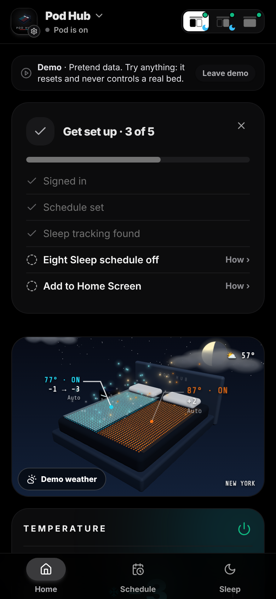
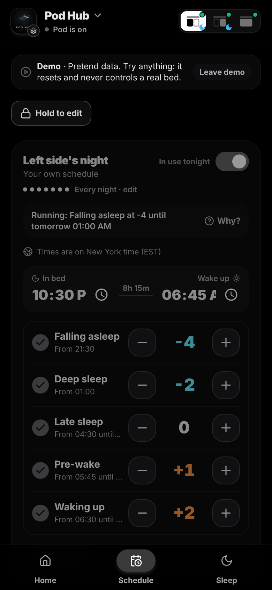
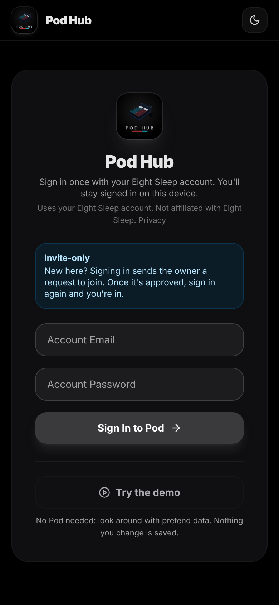

# Pod Hub

Your own sleep schedule and controls for an Eight Sleep Pod, with a 3D view of your bed. It's a free, invite-only web app that installs on your phone like a native app.

> **An honest note.** This is a personal project I built for my own bed, with a lot of help from AI, and I'm sharing it as-is. It works for me; it may not work for you, and I can't promise support. It is **not affiliated with Eight Sleep**: it talks to Eight Sleep's unofficial app interface, which can change or stop working at any time. Use it at your own risk.

  
  
  

## What it does

| | |
|---|---|
| **Night schedule** | Three temperature stages (in bed → deep sleep → late sleep), each with its own start time and level. |
| **Pre-cool / pre-heat** | The bed starts cooling or warming 0–60 min before you get in. |
| **Wake-up warmth** | The bed warms to a set level shortly before wake-up, then turns off. |
| **Presets** | Save schedules as presets and switch with one tap. The active preset is always shown. |
| **Tonight's curve** | A time-accurate chart of the night: when the pod turns on, each level, the alarm, and when it powers off. |
| **Manual control** | A − / + stepper with an explicit **Set level** button, so nothing changes by accident. Power on/off. |
| **Nap & Hot-flash** | The pod's built-in quick modes, shown only if your account supports them. |
| **Sleep stats** | Last night's score, time asleep, light/deep/REM, heart rate, HRV, breathing, bed and room temperature, and a 7-night trend. |
| **Vacation mode** | Pauses the schedule, turns on Eight Sleep's Away mode, and resumes automatically on a chosen date. |
| **Pod health** | Connection, water, priming status, **Prime now**, LED brightness. |
| **Cron history** | A 3-day log of every schedule check: what changed, what didn't, and any errors. |
| **Capabilities check** | Shows which Eight Sleep features your account can use. |
| **Installable app** | Full-screen Android/iOS app that stays signed in. |

## How it works

Pod Hub keeps your schedule in its own database. An external scheduler calls `/api/temperatureCron` every 5 minutes. Each call checks the time in your timezone and tells the Pod what to do: turn on, change level, or turn off. The app runs on Vercel's free plan, which only runs code when a request comes in, so the external cron job acts as the app's alarm clock.

## Setup

1. **Deploy to Vercel.** Import this repository as a new Vercel project.
2. **Environment variables** (Project → Settings → Environment Variables):
   - `CRON_SECRET`: a random string. It protects the cron endpoint.
   - `JWT_SECRET`: a random string. It signs login sessions.
   - Optional: `NEXT_PUBLIC_DONATE_URL`, an https link (for example a PayPal.me address). When set, Settings shows a "Support" row that opens it. Leave it out for no link.
   - `APPROVED_EMAILS`: a comma-separated list of the Eight Sleep account emails allowed to sign in.
3. **Database.** In the project's Storage tab, create a Postgres database and connect it. This adds `POSTGRES_URL` and `POSTGRES_URL_NON_POOLING`.
4. **Build command.** Project → Settings → General → Build Command: `npm run build && npm run db:push`. Each deploy applies any new database changes in `drizzle/` (each file runs once and is remembered, so a normal deploy leaves the live tables alone).
5. **Deployment protection.** Disable "Vercel Authentication" so your phone and the cron job can reach the app.
6. **Redeploy**, open the app, sign in with your Eight Sleep account, and save a schedule.
7. **Cron job.** On [cron-job.org](https://cron-job.org), create a job:
   - URL: `https://<your-app>/api/temperatureCron`
   - Schedule: **every 5 minutes**. Longer gaps delay stage changes, and the wake-up alarm can be missed.
   - Header: `Authorization: Bearer <CRON_SECRET>`

   You can copy all three values from **Settings → Cron job** in the app.
8. **Install on your phone.** Android: Chrome → ⋮ → **Install app**. iPhone: Safari → Share → **Add to Home Screen**.

## Tech

Next.js 14 (App Router) · tRPC · Drizzle ORM + Postgres · Tailwind CSS · deployed on Vercel.

## Credits

- Built on [**eightsleep-nosub-app**](https://github.com/aerotow/eightsleep-nosub-app) by [@aerotow](https://github.com/aerotow). The original idea and the scheduling core come from there.
- The Eight Sleep API details come from the open-source [eight_sleep](https://github.com/lukas-clarke/eight_sleep) Home Assistant integration by @lukas-clarke, [pyEight](https://github.com/mezz64/pyEight) by @mezz64, and [eightctl](https://github.com/steipete/eightctl) by @steipete.
- Scaffolded with [create-t3-app](https://create.t3.gg).

## Try it first

A demo with pretend data runs at [podhub.online](https://www.podhub.online). Tap **Try the demo** on the sign-in screen: no account or Pod needed, nothing is saved and nothing reaches Eight Sleep. Real sign-in on that site is invite-only; to run Pod Hub for your own bed, deploy your own copy (see [Setup](#setup)).

## Test copies (staging)

Every Vercel preview can use its own test database (`STAGING_` variables) so you can try changes without touching your real data. See [docs/PREVIEWS.md](docs/PREVIEWS.md).

## License

GNU General Public License v3.0, the same as the project it is built on. See [LICENSE](LICENSE).

## Disclaimer

This is an unofficial project. It is not affiliated with or endorsed by Eight Sleep, Inc., and it uses an undocumented API that may change at any time. Use at your own risk. See [LICENSE](LICENSE).
